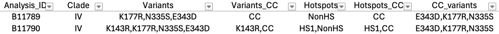

# GENEotyping — Identify amino acid variant haplotype of each sample in a VCF

We often refer to an isolate by any alleles at non-synonymous variants for any given gene. For example, a *C. auris* isolate that has the reference allele at all non-synonymous positions in FKS1 except for the S639Y variant (Serine at amino acid position 639 is mutated to Tyrosine) would be considered simply to be FKS1-S639Y. If no non-synonymous positions are mutated, it would be "WT", short for Wild-Type.

This document describes an R script that identifies amino acid variants for any given gene across all individuals in a VCF and outputs a table.

## Inputs

1. **Gene ID** (required string; formatted as e.g. `CJI82_03103` as in ERG11)
2. **VCF** (required file)
3. **Hotspots** (optional file: tab-separated; `Start_aa`, `End_aa`, and `Segment` columns. Identifies mutational hotspots in which the variants arise. Outputs an additional column `Hotspots` and possibly `Hotspots_CC` — see option 4)
4. **Clade-conserved variants** (optional file: tab-separated; `Analysis_ID` and `Clade` columns. Outputs additional columns `Clade`, `Variants_CC`, `CC_Variants`, and possibly `Hotspots_CC` — see option 3)
5. **Required amino acid positions** (optional): positions at which missing genotypes force the output `Variant` to `NA` regardless of other variants found (including samples that would otherwise be wild-type / WT)
6. **Flip positions** (optional): amino acid positions whose reference and alternate proteins should be swapped due to an artifact in the reference genome

## Script

```
scripts/identify_gene_variants.R
```

### Usage

```
Rscript scripts/identify_gene_variants.R [options]
```

### Options

| Flag | Description |
|------|-------------|
| `-g GENE, --gene=GENE` | Gene ID (e.g. `CJI82_03103`) |
| `-v VCF, --vcf=VCF` | Path to VCF file (snpEff annotated) |
| `-c CLADE, --clade=CLADE` | Optional: path to clade file (`Analysis_ID`, `Clade`) |
| `-s HOTSPOTS, --hotspots=HOTSPOTS` | Optional: hotspots file with `Start_aa`, `End_aa`, `Segment` |
| `-o OUT, --out=OUT` | Output TSV path. Default: `<gene>_variants.tsv` |
| `-l FLIP_VARIANTS, --flip_variants=FLIP_VARIANTS` | Comma-separated AA positions whose alt allele should be flipped with respect to the reference (e.g. `143`, which in ERG11 would flip R143K → K143R) |
| `-r REQUIRED_POSITIONS, --required_positions=REQUIRED_POSITIONS` | `all` or comma-separated AA positions to require (e.g. `143,640`). It is **strongly recommended** to include here any positions used in `--flip_variants` |
| `--verbose` | Print verbose debug messages |
| `--debug_isolates=DEBUG_ISOLATES` | Comma-separated isolates to dump debug info for when `--verbose` is set |
| `-h, --help` | Show help message and exit |

## Details

Required inputs are only a gene ID and a path to a VCF annotated with SnpEff v5. This SnpEff version is required because the R package [`gemmar`](https://github.com/Neato-Nick/gemmar) expects the `ANN` field from the VCF. With more loci and more samples, the script consumes more memory and takes longer. It is **strongly suggested** to filter the VCF to fewer than ~5000 variants, or fewer for large populations (n > 1000).

In basic usage, the output table contains the sample ID from the VCF and a comma-separated list of non-synonymous mutations. Optionally, tab-delimited files mapping isolates to clades and/or hotspot regions within the gene can be provided.

### Clade-conserved variants

When a clade mapping table is provided, additional columns `Variants_CC` and `CC_Variants` are output. `Variants_CC` lists variants pruned for clade-conserved ones (clade-conserved variants appear as `"CC"`), and `CC_Variants` lists the clade-conserved variants found. For a variant to be considered clade-conserved, it must be present in *strictly* 100% of all isolates within a clade.

### Hotspots

When a hotspots table is provided, additional columns `Hotspots` (and possibly `Hotspots_CC`) are output. These are comma-separated lists of which hotspot regions mutations fall in, optionally censored by clade-conserved status. If an isolate has only clade-conserved variants, `Hotspots_CC` reads simply as `"CC"`.

### `--flip_variants` and `--required_positions`

These options are useful when investigating known resistance genes.

**`--required_positions`:** For example, mutations to *C. auris* Fks1 position 639 are known to induce echinocandin resistance. Running with `--required_positions=639` causes the output variant for any isolate with a missing genotype at any position that could mutate the 639th amino acid to be reported as `NA` rather than WT.

**`--flip_variants`:** Useful when analyzing a gene with previously described variants that are flipped in the reference genome. For example, *C. auris* ERG11-K143R is known to affect triazole resistance, but amino acid position 143 is an R in the B11205 reference genome rather than K. This means most of the *C. auris* global population appears to have ERG11-R143K, which would be interpreted as a variant that *increases* azole susceptibility. Using `--flip_variants=143` causes the output to read `"WT"` for any isolate with K143 and `"K143R"` for any isolate with R143, so the output reflects variants that *decrease* azole susceptibility.

> **Note:** `--flip_variants` only works for bi-allelic loci. It will not work for any position with more than one alternate amino acid, since the logic cannot be simply reversed to consider WT as one specific other variant.

Variants are output in an abbreviated form of the [HGVS nomenclature](https://hgvs-nomenclature.org/stable/recommendations/general/). If the variant is complex, the parsed nomenclature may be incompletely abbreviated.

## Installation

The script can be run locally or remotely on OSCAR. All R dependencies must be installed first.

```bash
# If running on OSCAR, load R module first
ml r/4.5.1-3eqz7xk

# Then open an R shell and install packages
R
```

```r
options(repos = c(CRAN = "http://cran.r-project.org"))

install.packages(c("remotes", "optparse", "dplyr", "tidyr", "stringr", "readr", "vcfR", "purrr"))
remotes::install_bioc("Biostrings")
remotes::install_github("Neato-Nick/gemmar")
```

Exit the R shell before running the script.

## Tips

To detect wholly conserved variants even when the population is only one true clade, create a dummy clades file:

```bash
printf "Analysis_ID\tClade\n" > tmp.clades.tsv
bcftools query -l /path/to/some_population.vcf | awk '{print $1"\tfoobar"}' >> tmp.clades.tsv

Rscript scripts/identify_gene_variants.R -c tmp.clades.tsv -g gene1 -v /path/to/some_population.vcf
```

## Example Commands

**FKS1** (gene `CJI82_02060`, requiring position 639):

```bash
Rscript scripts/identify_gene_variants.R \
  -g 'CJI82_02060' \
  -v n1606.MRPAS75_PD-T.hard_filtered.snpEff.nonsynon.AFR_n36.vcf \
  -c mic_clinical_data_joined_updated.clades_only.tsv \
  -s ~/data/ref_genomes/Cauris/B11205/hotspots.FKS1.tsv \
  -r 639 \
  -o FKS1_variants.tsv \
  --verbose
```

**ERG11** (gene `CJI82_03103`, flipping and requiring position 143):

```bash
Rscript scripts/identify_gene_variants.R \
  -g 'CJI82_03103' \
  -v vcfs/n1606.MRPAS75_PD-T.hard_filtered.snpEff.nonsynon.AFR_n36.vcf \
  -c mic_clinical_data_joined_updated.clades_only.tsv \
  -s ~/data/ref_genomes/Cauris/B11205/hotspots.ERG11.tsv \
  -r 143 \
  -l 143 \
  -o ERG11_variants.tsv \
  --verbose
```

## Example Output



In the ERG11 example above (`CJI82_03103`), the script was run on 1606 *C. auris* isolates from six globally described clades. B11789 and B11790 are Clade IV isolates:

- **Variants:** B11789 has 3 variants; B11790 has 4 variants.
- **Variants_CC:** After checking for clade conservation, 3 of these collapse to `"CC"`.
- **CC_Variants:** The clade-conserved variants — found in 100% of Clade IV isolates in this population — are E343D, K177R, and N335S.
- **Hotspots:** All clade-conserved variants are non-hotspot mutations.
- **Hotspots_CC:** B11790 has the clade-conserved variants plus the non-clade-conserved K143R, which falls in HS1.

The reference genome *C. auris* B11205 encodes an arginine at codon 143, while the canonical reference isolate B8441 encodes a lysine. To be consistent with the literature referring to ERG11-K143R, `--flip_variants=143` was used so that the output reports most isolates as K143 (WT) rather than the misleading R143K.
